# Early Detection of Money Laundering Rings using Temporal Transaction Network Analytics and Explainable Risk Scoring

Developed as part of the course on "Forensic Analytics" at Vellore Institute of Technology, Chennai.  
by Keerthana A R(23MIA1096),Raagav(23MIA1052)
Subject Code: CSE4074  
Semester: Fall 2026-27  
Professor: Dr. S. Johanan Joysingh  

Repository name: `Early-AML-Warning-System`. A companion explanation of the project, written to run in parallel with the review presentation, is available as a self-contained web page: `PROJECT_EXPLAINED.html` (open it in any browser, no internet connection needed).

## At a Glance

| Item | Summary |
|---|---|
| Problem | Money-laundering rings are usually recognised only after the money has moved. Investigators need leads that arrive earlier, explain themselves, and point to the exact transactions. |
| Approach | Build candidate rings from transaction structure (no labels), score every candidate each day with a transparent four-component risk score, raise an alert at a score of 50, and keep a full evidence trail for each candidate. |
| Data | AMLSim simulated banking data: 197,905 transactions, 12,043 accounts, 720 daily windows, 100 labelled laundering rings. |
| Key result | The candidate queue warns before a ring completes for 17 of the 30 evaluable rings (median 4.0 days). The alerts are precise (82%, 0.004 false alerts per day) but early for 5 of 30 rings (median 1.0 day, 95% interval 0 to 5). |
| Honest finding | The early signal is largely driven by how AMLSim builds rings (members are otherwise-dormant accounts); a two-bit newness rule matches the learned model. This is reported, not hidden. |
| Deliverable | A reproducible pipeline, a 13-page investigator dashboard (React and FastAPI), 73 front-end tests and a 253-test backend suite (241 passing; the 12 failures are legacy tests of retired modules, see Section 15). |

## How to Review This Repository in Five Minutes

| If you want to see | Go to |
|---|---|
| The problem and why it matters | Section 2 |
| What is new in this work, and what is not claimed | Section 4 |
| The system design | Section 7 (architecture figure) |
| The exact scoring formula with a worked example | Section 8.4 and Figure 6 |
| Results with screenshots of the running system | Section 11 (Figures 1 to 13) |
| Comparison with the previous version of the project | Section 11.10 |
| Forensic-analytics relevance (evidence, traceability, reproducibility) | Section 13 |
| Limitations and threats to validity | Section 14 |
| How to run everything | Section 10 |

## Contents

1. [Abstract](#1-abstract)
2. [Problem Statement and Motivation](#2-problem-statement-and-motivation)
3. [Objectives and Research Questions](#3-objectives-and-research-questions)
4. [Contributions and Novelty](#4-contributions-and-novelty)
5. [Related Work and Research Gap](#5-related-work-and-research-gap)
6. [Dataset](#6-dataset)
7. [System Architecture](#7-system-architecture)
8. [Methodology](#8-methodology)
9. [Implementation](#9-implementation)
10. [Installation and Usage](#10-installation-and-usage)
11. [Results and Analysis](#11-results-and-analysis)
12. [Discussion: Key Findings](#12-discussion-key-findings)
13. [Forensic Analytics Perspective](#13-forensic-analytics-perspective)
14. [Limitations and Threats to Validity](#14-limitations-and-threats-to-validity)
15. [Testing and Quality Assurance](#15-testing-and-quality-assurance)
16. [Future Work](#16-future-work)
17. [Responsible Use](#17-responsible-use)
18. [Conclusion](#18-conclusion)
19. [References](#19-references)
20. [Team and Contributions](#20-team-and-contributions)
21. [Appendix: Glossary](#21-appendix-glossary)

## 1. Abstract

Money-laundering rings are groups of accounts that move funds through cycles, chains and fans so that the origin of the money is hidden. Most analytics report a ring only after the fact, and most evaluations never measure how early a warning could have been given. This project builds and evaluates a formation-stage early-warning system on the AMLSim simulated banking dataset (197,905 transactions, 12,043 accounts, 720 daily windows, 100 labelled rings).

The system builds 171 candidate rings without using any labels, from two complementary sources: graph structure (unordered cycle closure and partial paths) and groups of first-time accounts. Each candidate receives a 0 to 100 explainable risk score, recomputed as of every day it gains evidence, from four components: a behavioural model trained only on earlier data, network completeness, fund-flow patterns and persistence. A score of 50 raises an alert. Every candidate is linked to its accounts, transaction identifiers, patterns and a step-by-step score calculation.

Evaluated against AMLSim ground truth on the 30 rings that fall wholly inside the scored period, the whole queue sees 29 rings and warns before completion for 17 (median lead 4.0 days), while the 11 alerts are 82% precise but early for 5 rings (median lead 1.0 day). Controls show that the early signal rests largely on AMLSim's dormant-account construction, and the limits of the evidence are stated throughout.

## 2. Problem Statement and Motivation

Money laundering is conventionally described in three stages: placement of illicit funds into the financial system, layering through chains of transfers that obscure the origin, and integration of the funds back into the legitimate economy [10]. Layering is where network structure becomes visible: funds circulate through cycles, pass through intermediary accounts, or fan in to and out of hub accounts. A forensic investigator who sees these structures forming has a chance to act before the money leaves the system.

Three weaknesses of existing analytics motivate this work.

1. **Transactions are scored one at a time.** A single transfer rarely looks suspicious; the suspicion lies in how transfers connect over time.
2. **Alerts carry no explanation or evidence trail.** An investigator cannot act on an opaque score, and an examiner cannot reproduce it.
3. **Early warning is claimed but rarely measured.** Metrics such as precision and recall on labelled transactions do not say how many days before a ring completed the system raised its flag.

**Problem statement.** Given a stream of timestamped transactions, construct candidate money-laundering rings without labels, score each candidate every day using only the evidence available that day, raise alerts, keep an inspectable evidence trail, and measure against ground truth how long before a ring completed the warning arrived, at what false-alarm cost, and with what statistical confidence.

The central research question is therefore: **"How early can we know?"**

## 3. Objectives and Research Questions

| ID | Research question | Objective |
|---|---|---|
| RQ1 | Can formation-stage candidate rings be built from transaction structure alone, without labels? | Build label-free candidates from graph structure and account novelty. |
| RQ2 | Can a transparent 0 to 100 score prioritise candidates and explain itself to an investigator? | Define a four-component score whose every number can be recomputed from the evidence. |
| RQ3 | How many days before a ring completes does a warning arrive, and what does it cost in false alarms? | Evaluate lead time, coverage and false alerts per day against ground truth, with intervals. |
| RQ4 | Does the learned behavioural model add anything beyond simple shortcuts? | Run controls and ablations (newness rule, no-novelty model, random, candidate sources). |

## 4. Contributions and Novelty

**Contributions**

1. **Label-free candidate construction from two complementary sources.** Structure candidates (19) are clean but late; first-time-account groups (152) give most of the early warnings. Together they reach 29 of 30 evaluable rings.
2. **An as-of-day, out-of-sample, explainable risk score.** The score is recomputed on every day a candidate gains evidence, using a model trained only on earlier data. A calculation card reproduces each number from the code's own constants.
3. **A ring-level early-warning evaluation protocol.** Lead time against ring completion, ring-transaction coverage, false alerts per day, bootstrap and Wilson intervals, retraining stability, and operating points at six thresholds.
4. **Controls that expose the dataset shortcut.** A newness rule, a model without novelty features and a random policy are evaluated on the same rings, so the reader can see what the model does and does not add.
5. **An investigator dashboard with an evidence trail.** Thirteen pages link every score to accounts, transaction identifiers, patterns and the day-by-day score history.

**What is not claimed.** Temporal graphs, explainable scoring and lead-time evaluation are treated as components of one pipeline, not as individually new techniques. The proposed classifier is not shown to beat a random-forest baseline (Section 11.8). No claim is made about real-world performance, because all results come from one simulated dataset.

## 5. Related Work and Research Gap

Graph-based anti-money-laundering research has moved from rule systems towards learned representations. Weber et al. gave a first look at scalable graph learning for anti-money laundering [1] and applied graph convolutional networks to Bitcoin transactions for financial forensics [2]. Altman et al. released realistic synthetic transaction benchmarks with laundering patterns [3], and Bellei et al. proposed subgraph representation learning on the Elliptic2 blockchain dataset [4]. Tree ensembles and anomaly detectors remain strong, transparent baselines [5, 6, 7].

| Gap in existing work | Objective | Module in this project | Metric reported |
|---|---|---|---|
| Transactions are classified independently of their network and time context | RQ1 | `src/pipeline_v2/core.py`, `src/evaluation/candidates_v2.py` | Ring-transaction share, coverage |
| Scores are not explained or traceable to evidence | RQ2 | `src/pipeline_v2/score_calculation.py`, `src/evidence/` | Score calculation card, evidence graph |
| Early warning is claimed but not measured | RQ3 | `src/pipeline_v2/evaluate.py`, `src/pipeline_v2/warning_log.py` | Lead time, false alerts per day, intervals |
| Gains on simulated data may come from simulator shortcuts | RQ4 | `src/pipeline_v2/models.py`, ablation controls | Newness-rule and no-novelty controls |
| Severe class imbalance hides weak models behind accuracy | RQ3, RQ4 | `src/evaluation/account_window_eval.py` | PR-AUC, precision at K, Wilson intervals [8, 9] |

## 6. Dataset

The project uses the **AMLSim** simulator output [11] (real simulator files, not demonstration data). AMLSim generates normal banking traffic and injects laundering rings of known type, so ground truth is exact. All data are synthetic; no real customer information is involved.

| Property | Value |
|---|---|
| Transactions | 197,905 |
| Accounts | 12,043 |
| Time span | 720 daily windows (one window per day) |
| Labelled rings | 100: 40 cycle, 30 fan-in, 30 fan-out |
| Alert-linked transactions in the ground truth | 671 |
| Warm-up excluded from scoring | First 120 days of simulator warm-up for modelling; candidates are built from day 240 onward |
| Scored period | Day 240 to 719 (480 days) |
| Evaluable rings | 30 (all cycles): every transaction inside the scored period and the ring completes within the data |
| Rings not evaluable | 70: all 30 fan-in, all 30 fan-out and 10 cycles, because they begin before day 240 |

**How labels are used.** Ring labels are used in exactly two places: as training targets for rows strictly before a scored block (with a purge gap), and in evaluation code. They never enter candidate construction or any score.

**A property of the simulator that matters.** AMLSim draws ring members from otherwise-dormant accounts, so a first-time account is unusually informative here. Section 11.9 measures how much of the result depends on this.

## 7. System Architecture

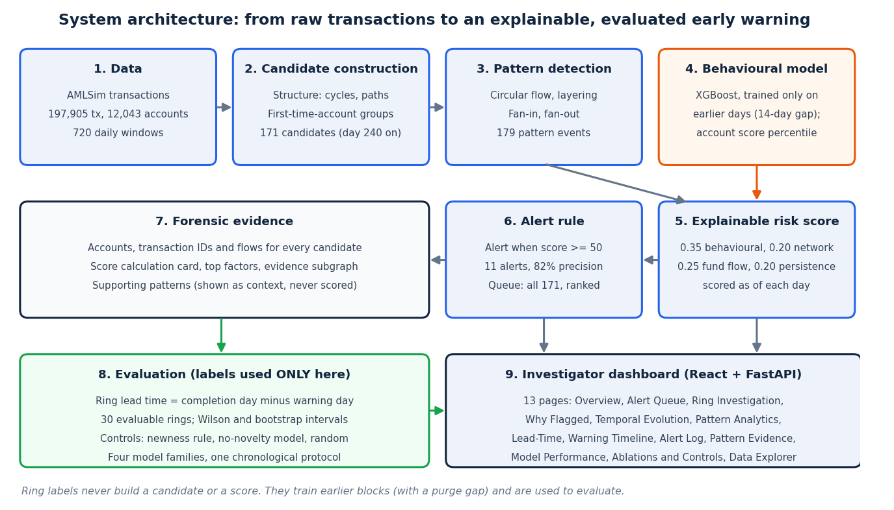

*Figure 0. System architecture. Candidates are built without labels, scored as of each day with an out-of-sample behavioural model, turned into alerts and evidence, and only then compared with ground truth.*

| Stage | What it does | Main code |
|---|---|---|
| 1. Data | Loads AMLSim transactions, cleans them, builds one-day windows | `src/data/`, `src/preprocessing/`, `src/temporal/`, `scripts/prepare_data.py` |
| 2. Candidate construction | Structure candidates and first-time-account groups, from day 240 | `src/pipeline_v2/core.py`, `src/evaluation/candidates_v2.py` |
| 3. Pattern detection | Circular flow, layering, fan-in, fan-out events on each candidate | `src/pipeline_v2/core.py`, `src/patterns/` |
| 4. Behavioural model | XGBoost forecast trained only on earlier days, with a purge gap | `src/pipeline_v2/models.py`, `src/evaluation/account_window_eval.py` |
| 5. Risk score | Four weighted components, recomputed as of each day | `src/pipeline_v2/core.py`, `configs/config.yaml` |
| 6. Alert rule | Alert at a score of 50; the queue holds every candidate, ranked | `src/pipeline_v2/warning_log.py` |
| 7. Forensic evidence | Accounts, transaction IDs, flows, score card, supporting patterns | `src/pipeline_v2/score_calculation.py`, `src/pipeline_v2/supporting_patterns.py`, `src/evidence/` |
| 8. Evaluation | Lead time, coverage, false alerts, intervals, stability, controls | `src/pipeline_v2/evaluate.py`, `src/pipeline_v2/pattern_evidence.py` |
| 9. Dashboard | Thirteen pages served by FastAPI and rendered by React | `backend/`, `frontend/` |

## 8. Methodology

### 8.1 Temporal graph windows

Transactions are grouped into one-day windows (window size and step are both one day, set in `configs/config.yaml`). This gives 720 windows. A candidate is described by the windows in which it gained evidence, so its history can be replayed day by day.

### 8.2 Candidate construction (no labels)

Two sources produce candidates. Both read only transaction fields (sender, receiver, amount, timestamp).

1. **Structure candidates.** Unordered cycle closure inside a sliding window (21 days by default) and path-like partial cycles. Cycles are detected without requiring the edges to arrive in order, because in AMLSim the edges of a cycle arrive in arbitrary order. In the first version of this project, detectors that required time-ordered cycles found none of the 40 cycle rings. This source yields **19** candidates.
2. **First-time-account groups.** A transaction whose sender or receiver has never been active before (after a warm-up) is a seed. Seeds are grouped by a shared account within a short gap, and by a shared hub across a longer gap (slow-drip fans). This source yields **152** candidates.

Together they give **171** candidates, evaluated from day 240.

### 8.3 Pattern detection

Each candidate carries pattern events. The detectors keep internal labels and are reported under the project's original pattern names:

| Reported pattern | Meaning | Fund-flow weight |
|---|---|---|
| Circular flow | A closed cycle of money | 3 |
| Layering | A path or chain of transfers, including chains through new accounts | 2 |
| Fan-in | One account receiving from several new counterparties | 1 |
| Fan-out | One account paying several new counterparties | 1 |

A single first-time-account transfer is a seed, not a pattern: it stays in the evidence and in the score but is not listed as a pattern. The run produces 179 pattern events (fan-out 135, layering 21, circular flow 14, fan-in 9). Four of the original eight pattern types are not produced by this pipeline (split and merge, rapid pass-through, repeated intermediary, escalating connectivity); the dashboard states this.

### 8.4 Explainable risk score

The score is an **investigative priority from 0 to 100, not a probability of guilt.** It is computed as of each day a candidate gains evidence, using only the evidence available on that day:

```text
score = 0.35 x behavioural + 0.20 x network + 0.25 x fund_flow + 0.20 x persistence
```

| Component | Weight | How it is calculated |
|---|---|---|
| Behavioural | 35% | Mean, over the candidate's accounts, of the percentile of each account's model score within a fixed reference population (active accounts in the days before the block). The model was trained only on earlier data. |
| Network | 20% | Structural completeness: closed cycle 100; path-like partial cycle 60; first-time-account groups 20 per seed (plus 20 for a slow-drip fan and 10 for a new-account chain), capped at 100. Independent of candidate size. |
| Fund flow | 25% | Sum of the weights of the distinct patterns present, divided by the sum of all weights (10), times 100. Circular flow alone gives 30. |
| Persistence | 20% | `35 x ln(1 + 3 x evidence transactions / accounts)`, capped at 100. |

Levels: LOW 0 to 24, MODERATE 25 to 49, HIGH 50 to 74, CRITICAL 75 to 100. **Alert threshold: 50.** Weights, bands and the threshold are read from `configs/config.yaml`; they were fixed before the evaluation and were not tuned to the results.

**Worked example (candidate RING0088, shown in Figure 6).** Seven accounts, seven transactions, one closed cycle.

| Component | Value | Weight | Points |
|---|---|---|---|
| Behavioural | 71.2 (highest account at the 99th percentile) | 35% | 24.92 |
| Network | 100.0 (closed cycle) | 20% | 20.00 |
| Fund flow | 30.0 (circular flow, weight 3 of 10) | 25% | 7.50 |
| Persistence | 48.5 (`35 x ln(1 + 3 x 7/7)`) | 20% | 9.70 |
| **Risk score** | HIGH | | **62.12** |

### 8.5 Behavioural model

An XGBoost classifier [7] forecasts, for each account on each day, whether the account will take part in a ring transaction within the next 14 days. Candidates are scored in 120-day blocks starting at day 240, and the model for each block is trained only on data strictly before that block, with a purge gap of 14 days (the forecast horizon) at the boundary, so no label ever looks into the future. Its output enters the score only through the account-percentile in the behavioural component. The model is retrained with five different random seeds to measure stability (Section 11.6).

### 8.6 Alert rule and queue

The **queue** is every candidate, ranked by current risk score. An **alert** is raised on the first day a candidate's score reaches the threshold of 50. The alert stays on record even if the score later falls; the Alert Log shows both the score at the alert and the current score.

### 8.7 Explainability and evidence

For every candidate the system stores and displays: the accounts and their roles, every transaction (identifier, sender, receiver, amount, time), the patterns, the four component values, the top contributing factors in words, the formula-level score calculation, and the day-by-day history of the score. Patterns found on the candidate's accounts by the original detectors are listed separately as context and are never scored, because a measured test showed they do not separate rings from normal traffic (AUC 0.34, below chance).

### 8.8 Evaluation protocol

The same definitions are used for every candidate set, so results are comparable.

| Term | Definition |
|---|---|
| Observable time (cycle) | Day of the closing (last) transaction of the ring |
| Warning time | First day a candidate that contains a transaction of the ring exists (queue), or first day such a candidate scores 50 or more (alert) |
| Lead time | Observable day minus warning day, in days. Positive means the warning came before the ring completed. |
| Evaluable ring | All transactions inside the scored period (from day 240) and the ring completes within the data |
| Coverage | Share of a ring's transactions that sit inside warning candidates |
| Ring-transaction share | Share of candidate transactions that belong to a ring, compared with the background rate |

Statistics: Wilson intervals for proportions [8], bootstrap interval for the median lead, and retraining stability over five seeds. Because positives are extremely rare, model comparison uses PR-AUC and precision at K rather than accuracy [9].

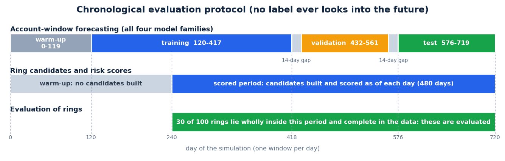

*Figure 0b. Chronological splits. The behavioural task is trained on days 120 to 417, validated on 432 to 561 and tested once on 576 to 719, with a 14-day gap between periods. Rings are evaluated inside the scored period from day 240.*

## 9. Implementation

### 9.1 Technology stack

| Layer | Technology |
|---|---|
| Language and data | Python 3.10 or newer, pandas, NumPy |
| Graph analysis | NetworkX |
| Machine learning | scikit-learn (Isolation Forest, logistic regression, random forest), XGBoost, SHAP for earlier explanation experiments |
| Backend | FastAPI, Uvicorn, Pydantic, SQLAlchemy; SQLite by default (`data/aml.db`), PostgreSQL optional |
| Frontend | React 18, Vite 5, React Router, Recharts, Tailwind CSS 3 |
| Testing | pytest (backend), Vitest with Testing Library and jsdom (front end) |
| Packaging | Docker and docker-compose |

### 9.2 Repository structure

```text
Early-AML-Warning-System/
  README.md                      this file
  PROJECT_EXPLAINED.html         self-contained explanation of the project
  configs/                       config.yaml (windows, patterns, scoring), dataset and model configs
  data/raw/amlsim/               AMLSim transactions, accounts and ground-truth files
  data/processed/                cleaned transactions (generated)
  src/
    data/ preprocessing/ temporal/ graph/      data loading, cleaning, windows, graphs
    patterns/ ring/ scoring/ features/         original pattern detectors and supporting code
    pipeline_v2/                               candidates, scoring, models, evaluation, warning log, score card
    evaluation/                                candidate and account-window evaluation, ring lead time
    evidence/ explainability/                  evidence subgraphs and explanations
  scripts/                       prepare_data.py, rebuild_v2.py, load_database.py, ...
  backend/                       FastAPI application (api, database, schemas, services)
  frontend/                      React application (src/pages, src/components, vtest)
  results/                       generated JSON results read by the dashboard
  docs/                          architecture, dataset, limitations, API, research mapping, images
  tests/                         backend test suite
```

Note on the `docs/` folder. `docs/REBUILD_V2.md`, `docs/NEW_PAGES.md`, `docs/PATTERN_INVESTIGATION.md`, `docs/FIXES_FROM_REVIEW.md` and `docs/IMPROVED_METRICS.md` describe the current pipeline. `docs/architecture.md`, `docs/limitations.md` and `docs/research_mapping.md` were written for the first version of the project (trajectory-based candidates) and are superseded by Sections 5, 7 and 14 of this README; `docs/dataset.md` and `docs/api.md` remain valid.

### 9.3 Dashboard pages

| Page | Purpose |
|---|---|
| Overview | Headline counts, risk distribution, warning cards, detection funnel |
| Alert Queue | All 171 candidates ranked, with filters and the alert given |
| Ring Investigation | One candidate in full: score, window, patterns, warning given, evidence graph, transactions |
| Why Flagged | Component bars and top contributing factors |
| Temporal Evolution | Pattern sequence, window span, and the score calculation card |
| Pattern Analytics | Distribution of pattern events and what the pipeline does not detect |
| Lead-Time Analytics | Protocol, alerts, queue, operating points, stability, ranking quality |
| Warning Timeline | Every evaluable ring aligned at completion with queue and alert markers |
| Alert Log | Every alert with score at alert, current score, evidence and outcome |
| Pattern Evidence | How pattern count and type relate to score and to rings |
| Model Performance | Four model families under one protocol |
| Ablations and Controls | Candidate sources, controls and horizon sensitivity |
| Data Explorer | Transaction-level view with ground-truth labels |

### 9.4 REST API

| Endpoint | Returns |
|---|---|
| `GET /api/summary`, `/api/pipeline-stats`, `/api/evaluation-context` | Headline counts and evaluation context |
| `GET /api/alerts`, `/api/rings`, `/api/rings/{id}` | Alert queue and candidate detail |
| `GET /api/rings/{id}/graph`, `/timeline`, `/patterns`, `/evidence`, `/explanation` | Evidence for one candidate |
| `GET /api/score-calculation/{id}` | Step-by-step score for one candidate |
| `GET /api/warnings`, `/api/lead-time`, `/api/ring-early-warning` | Warning log and lead-time evaluation |
| `GET /api/pattern-evidence`, `/api/supporting-patterns`, `/api/patterns` | Pattern analyses |
| `GET /api/metrics`, `/api/models`, `/api/transactions`, `/api/accounts/{id}` | Model metrics and raw records |

Interactive documentation is generated at `http://localhost:8000/docs`.

## 10. Installation and Usage

### 10.1 Prerequisites

Python 3.10 or newer, Node.js 18 or newer (the tests were run on Python 3.12 and Node.js 22), and about 2 GB of free disk space. The AMLSim files are in `data/raw/amlsim/`.

### 10.2 Install

```powershell
python -m venv .venv
.venv\Scripts\activate            # Linux or macOS: source .venv/bin/activate
pip install -r requirements.txt
cd frontend
npm install
cd ..
```

### 10.3 Reproduce all results

```powershell
python scripts/prepare_data.py        # cleans the raw AMLSim files into data/processed/transactions_clean.csv
python scripts/rebuild_v2.py all      # candidates, scoring, four model families, stability, export (about 9 minutes)
python scripts/load_database.py       # loads the results into data/aml.db for the API
```

`rebuild_v2.py` can also be run one stage at a time (`candidates`, `scoring`, `models`, `stability`, `export`); each stage is resumable and writes to `results/v2_work/`. It first backs up earlier results to `results/v1_backup/` instead of deleting them.

### 10.4 Run the dashboard

```powershell
uvicorn backend.main:app --reload     # API at http://localhost:8000  (documentation at /docs)
cd frontend
npm run dev                           # dashboard at http://localhost:5173
```

Docker alternative: `docker-compose up --build`.

### 10.5 Run the tests

```powershell
pytest tests -q                       # backend
cd frontend
npx vitest run                        # front-end page tests
```

### 10.6 Expected output after a rebuild

| Check | Expected |
|---|---|
| Candidates | 171 (19 structure, 152 first-time-account groups) |
| Pattern events | 179 (fan-out 135, layering 21, circular flow 14, fan-in 9) |
| Queue-level result | 29 of 30 rings seen, 17 warned before completion, median lead 4.0 days |
| Alert-level result | Between 11 and 16 alerts depending on the random seed; the run documented here has 11 |

Queue-level figures are deterministic. Alert-level figures depend on the retrained behavioural model, which is why the dashboard reports the range over five seeds.

## 11. Results and Analysis

All figures below are screenshots of the running dashboard, taken from the run documented in this repository. Ring labels (AMLSim ground truth) are used only to produce the evaluation numbers.

### 11.1 Headline results

| Measure | Alerts (score 50 or more) | Whole queue (all 171 candidates) |
|---|---|---|
| Candidates | 11 alerts | 171 |
| Rings seen (of 30 evaluable) | 9 | 29 |
| Warned before ring completion | 5 (17%) | 17 (57%) |
| Warned exactly at completion | 4 | 12 |
| Warned after completion | 0 | 0 |
| Median lead time | 1.0 day (95% interval 0 to 5) | 4.0 days |
| Ring-transaction share | 77.9% | 29.6% (108.5 times the background rate) |
| Ring-transaction coverage | 26% | 84% |
| False alerts or candidates per day | 0.0042 (2 false alerts in 480 days) | 0.26 |
| Alert precision | 82% (9 of 11 contain ring transactions) | not applicable |
| Ranking quality of the queue | 80% of the top 10, 85% of the top 20 and 56% of the top 50 contain ring transactions; AUC 0.78 over 171 candidates (47 contain ring transactions) | |

### 11.2 Executive overview

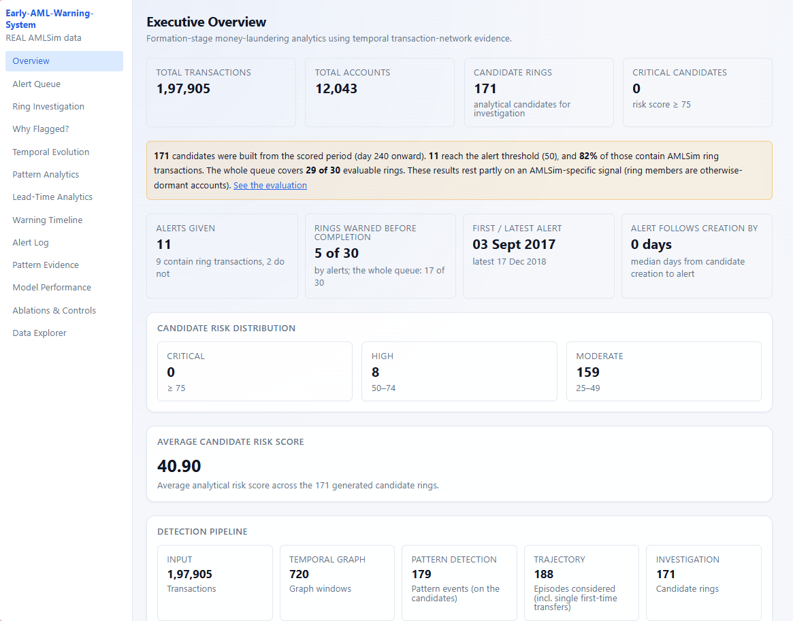

*Figure 1. Executive Overview. 171 candidates were built from the scored period; 11 reach the alert threshold; the queue covers 29 of 30 evaluable rings. A banner states that the results rest partly on an AMLSim-specific signal.*

The page reports the counts that frame everything else: 197,905 transactions, 12,043 accounts, 171 candidate rings, no CRITICAL candidate, 8 HIGH and 159 MODERATE, with an average score of 40.90. The four warning cards give the alert count, the number of rings warned before completion (5 by alerts, 17 by the queue), the first and latest alert (03 Sept 2017 and 17 Dec 2018) and the median time from candidate creation to alert (0 days).

### 11.3 Investigator alert queue

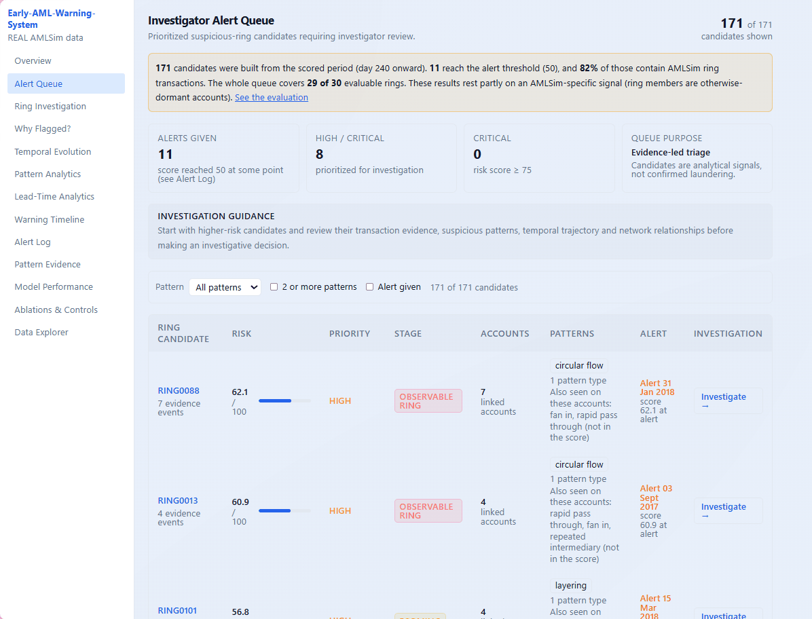

*Figure 2. Alert Queue. All 171 candidates are shown, with the risk bar, priority, formation stage, accounts, patterns and the alert given (for example "Alert 31 Jan 2018, score 62.1 at alert"). Filters select a pattern, candidates with two or more patterns, or only those that raised an alert.*

The queue is sorted by risk. Each row links to the full investigation. The "Also seen on these accounts" line lists context patterns from the original detectors; it is labelled "not in the score". Three candidates just below the threshold (49.3 to 49.4) have no alert, which shows how sensitive alert counts are to the threshold.

### 11.4 Investigating and explaining one candidate

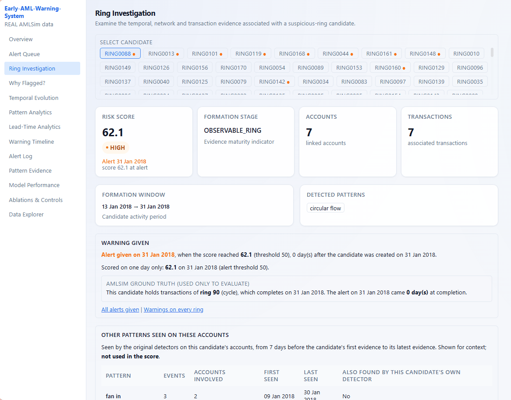

*Figure 3. Ring Investigation for RING0088: risk score 62.1 (HIGH), seven linked accounts, seven transactions, formation window 13 to 31 Jan 2018, pattern circular flow. The Warning Given panel states that the alert came on 31 Jan 2018 at the completion of ring 90.*

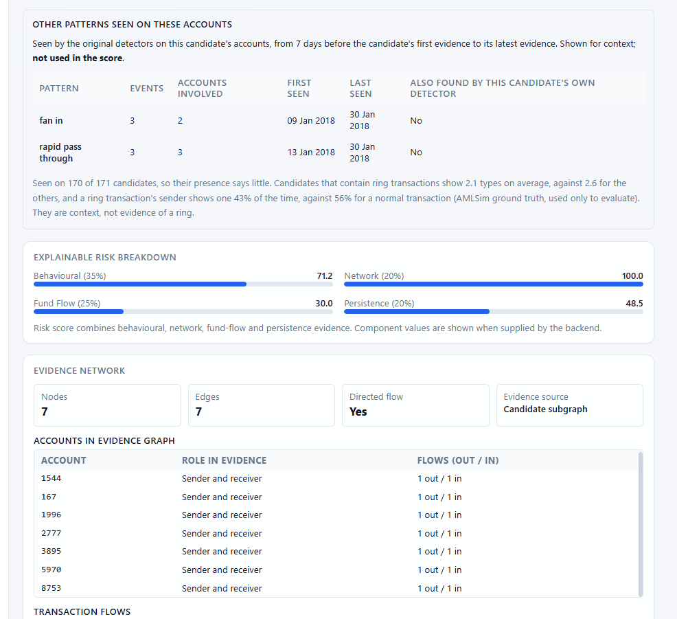

*Figure 4. Explainable risk breakdown (behavioural 71.2, network 100.0, fund flow 30.0, persistence 48.5) and the evidence network (nodes, edges, accounts and their roles).*

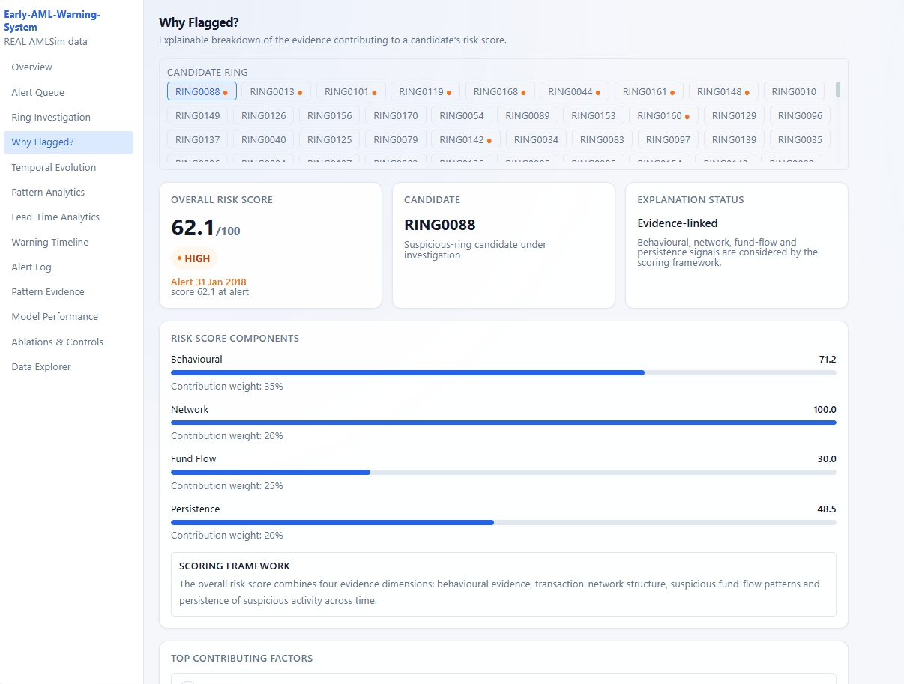

*Figure 5. Why Flagged. Component bars with their contribution weights (35%, 20%, 25%, 20%) and the alert badge.*

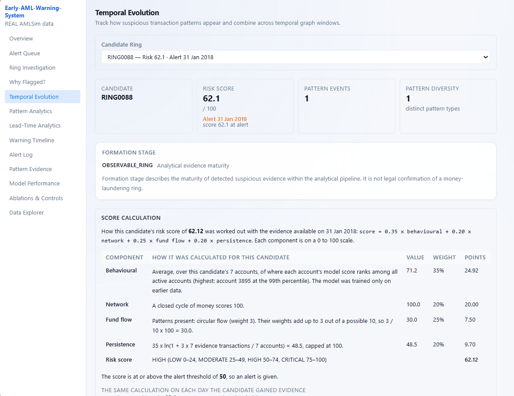

*Figure 6. Temporal Evolution with the score calculation card. Each component is explained from the code's own rules and the total reproduces the score: 24.92 + 20.00 + 7.50 + 9.70 = 62.12.*

An investigator can follow the chain from the alert to the seven transfers (13 to 31 Jan 2018, amounts between 294.64 and 927.73) that close the cycle, to the accounts that took part, and to the arithmetic that produced the score. The page also states that the candidate "represents a computationally detected suspicious transaction-ring hypothesis" and that conclusions must follow review of the underlying transactions.

### 11.5 Patterns and pattern evidence

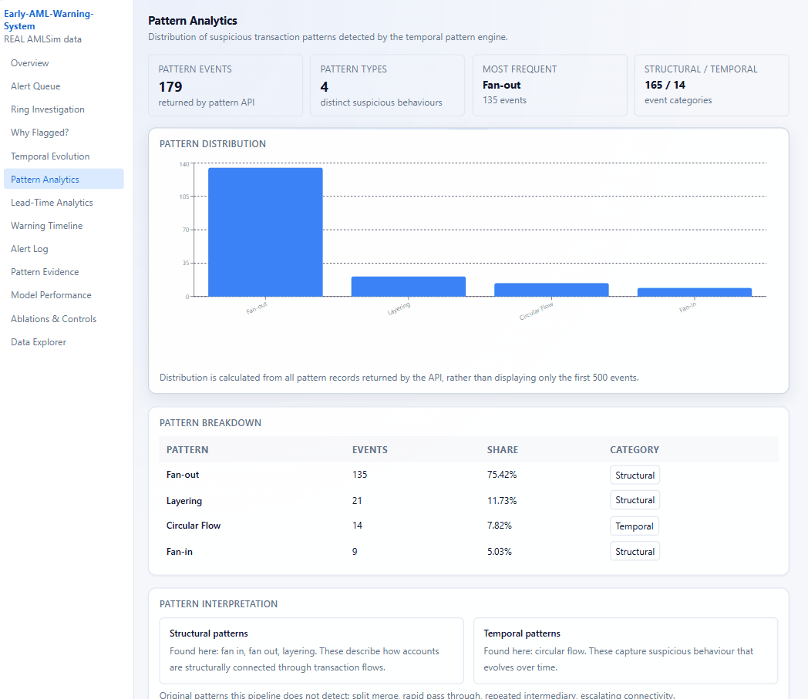

*Figure 7. Pattern Analytics. 179 pattern events of four types: fan-out 135 (75.4%), layering 21, circular flow 14 and fan-in 9; 165 structural and 14 temporal events.*

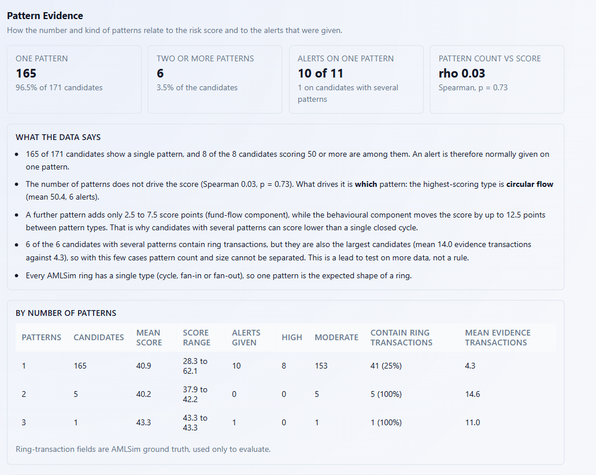

*Figure 8. Pattern Evidence. 165 of 171 candidates show one pattern; the number of patterns is unrelated to the score (Spearman 0.03, p = 0.73).*

Key numbers: circular flow candidates average a score of 50.4 and 13 of 14 contain ring transactions; layering averages 45.3 and all 16 contain ring transactions; fan-in 6 of 6; fan-out only 6 of 129 (5%). So 123 of the 124 candidates that contain no ring transaction are fan-out groups, and a second pattern adds only 2.5 to 7.5 score points. The six multi-pattern candidates are also the largest (mean 14.0 evidence transactions against 4.3), so pattern count and size cannot be separated with six cases.

### 11.6 Early-warning evaluation

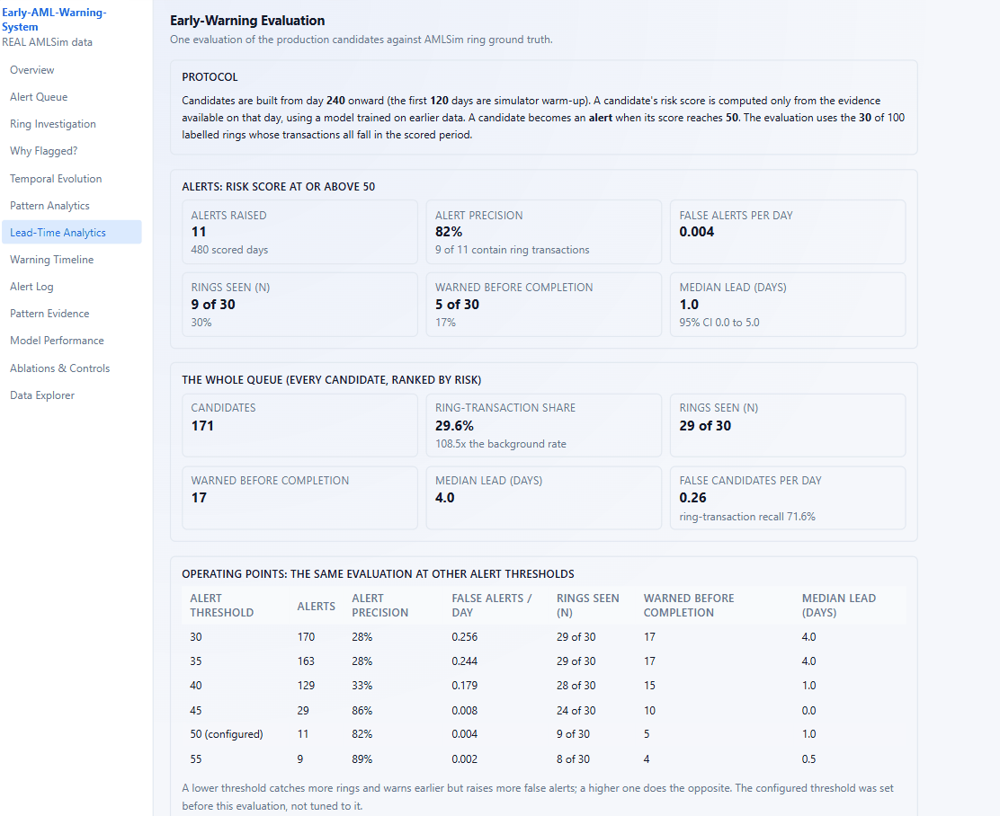

*Figure 9. Lead-Time Analytics: protocol, alert-level and queue-level results, operating points at six thresholds, and stability across five retrainings.*

**Operating points** (same evaluation at other alert thresholds; the configured value was set before the evaluation and not tuned):

| Alert threshold | Alerts | Alert precision | False alerts per day | Rings seen | Warned before completion | Median lead (days) |
|---|---|---|---|---|---|---|
| 30 | 170 | 28% | 0.256 | 29 of 30 | 17 | 4.0 |
| 35 | 163 | 28% | 0.244 | 29 of 30 | 17 | 4.0 |
| 40 | 129 | 33% | 0.179 | 28 of 30 | 15 | 1.0 |
| 45 | 29 | 86% | 0.008 | 24 of 30 | 10 | 0.0 |
| **50 (configured)** | **11** | **82%** | **0.004** | **9 of 30** | **5** | **1.0** |
| 55 | 9 | 89% | 0.002 | 8 of 30 | 4 | 0.5 |

**Stability across five retrainings of the behavioural model** (queue-level figures cannot move; alert-level figures can, because many candidates score just below 50):

| Measure | This run | Median | Range |
|---|---|---|---|
| Alerts raised | 11 | 14 | 11 to 16 |
| Alert precision | 82% | 86% | 82% to 88% |
| Rings seen (of 30) | 9 | 11 | 9 to 13 |
| Warned before completion | 5 | 6 | 5 to 6 |
| Median lead (days) | 1.0 | 1.0 | 0.0 to 1.0 |
| Ranking AUC | 0.78 | 0.77 | 0.76 to 0.78 |
| HIGH candidates | 8 | 10 | 8 to 12 |

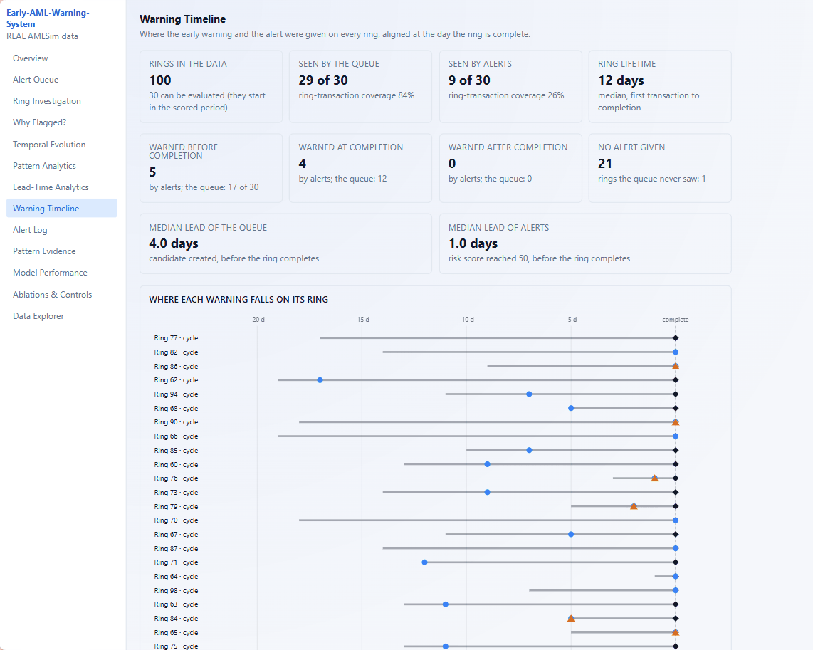

*Figure 10. Warning Timeline. Thirty cycle rings are aligned at the day they complete (dashed line). A blue dot is the first day a candidate holding the ring's transactions existed; an orange triangle is the day such a candidate reached the alert threshold.*

Reading the timeline: alerts warn before completion for 5 rings (leads of 1, 2, 4, 5 and 10 days), exactly at completion for 4 and never for 21. The queue warns before completion for 17 rings and at completion for 12; only one ring (Ring 77) is never seen. The median ring lasts 12 days from first transaction to completion. Against a ring's first transaction the median lead is -3.0 days, which means warnings come about 3 days after a ring starts; the lead reported above is therefore measured against completion, not against the ring's start. The page also lists the 70 rings that cannot be evaluated and why.

### 11.7 Alert log

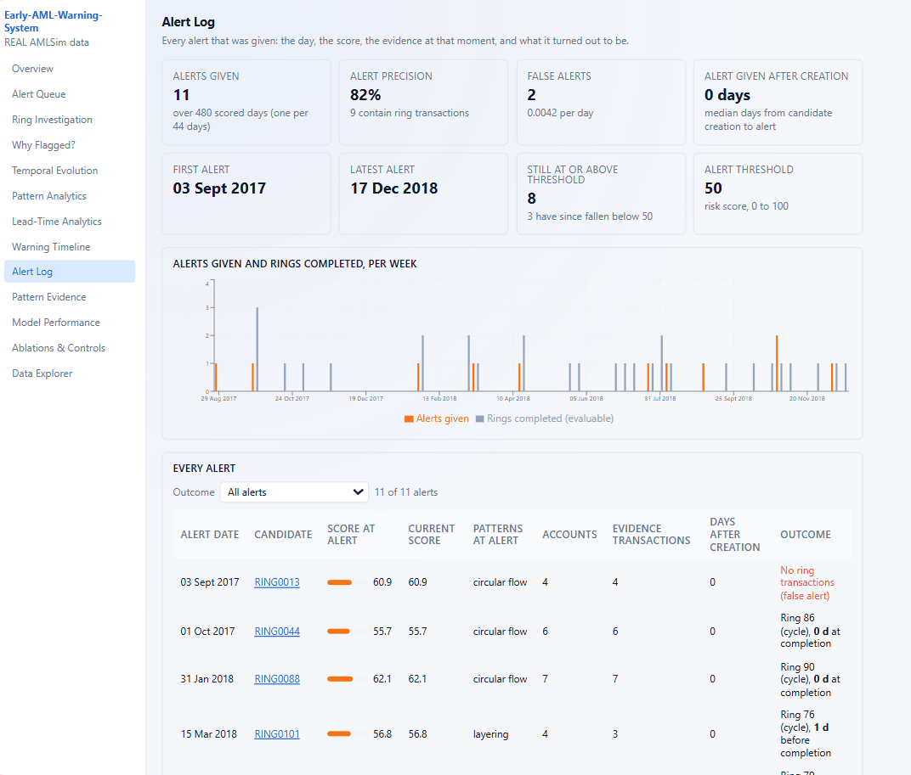

*Figure 11. Alert Log. Every alert with its date, score at the alert, current score, patterns at the alert, accounts, evidence transactions, days after creation and outcome.*

Eleven alerts were given over 480 scored days, about one every 44 days. Nine contain ring transactions (82%). The two false alerts are RING0013 (a clean four-account circular flow) and RING0148 (a fan-out of two transactions). Eight alerts are still at or above 50 and three have since fallen below it (RING0136, RING0142, RING0160). All five early alerts involve layering; the four true circular-flow alerts arrived exactly at completion. RING0160 alerted as layering and later closed into a cycle, and the log shows both states ("layering, now: circular flow").

### 11.8 Model performance

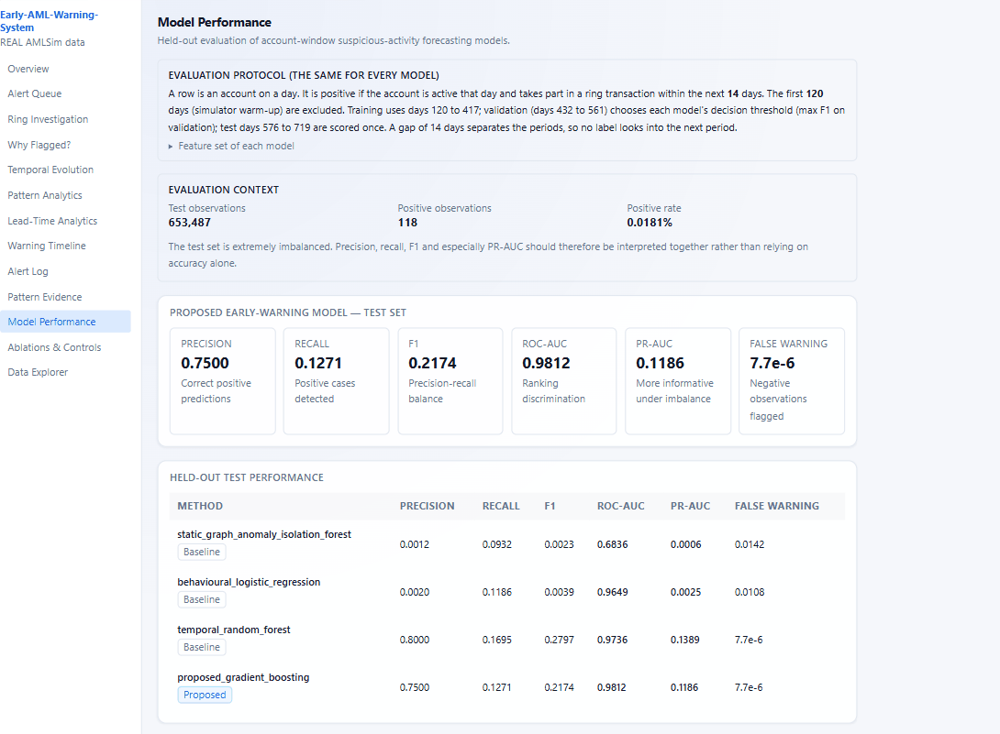

*Figure 12. Model Performance. Four model families evaluated under one chronological protocol on the 14-day forecasting task (118 positives among 653,487 test rows, a positive rate of 0.0181%).*

| Method | Precision | Recall | F1 | ROC-AUC | PR-AUC | False-warning rate |
|---|---|---|---|---|---|---|
| Static graph anomaly (Isolation Forest) | 0.0012 | 0.0932 | 0.0023 | 0.6836 | 0.0006 | 0.0142 |
| Behavioural logistic regression | 0.0020 | 0.1186 | 0.0039 | 0.9649 | 0.0025 | 0.0108 |
| Temporal random forest | 0.8000 | 0.1695 | 0.2797 | 0.9736 | 0.1389 | 7.7e-6 |
| **Proposed gradient boosting (XGBoost)** | 0.7500 | 0.1271 | 0.2174 | 0.9812 | 0.1186 | 7.7e-6 |

Precision at 10, 20 and 50 for the proposed model is 80%, 75% and 60%. **The proposed model does not beat the temporal random forest** on precision, recall, F1 or PR-AUC; it has the highest ROC-AUC. With only 118 positives the differences are small, so the contribution of this project is the pipeline (candidates, explainable score, early-warning evaluation) rather than a better classifier. These metrics evaluate the account-window forecasting task, which is different from the ring-level evaluation in Section 11.6.

### 11.9 Ablations and controls

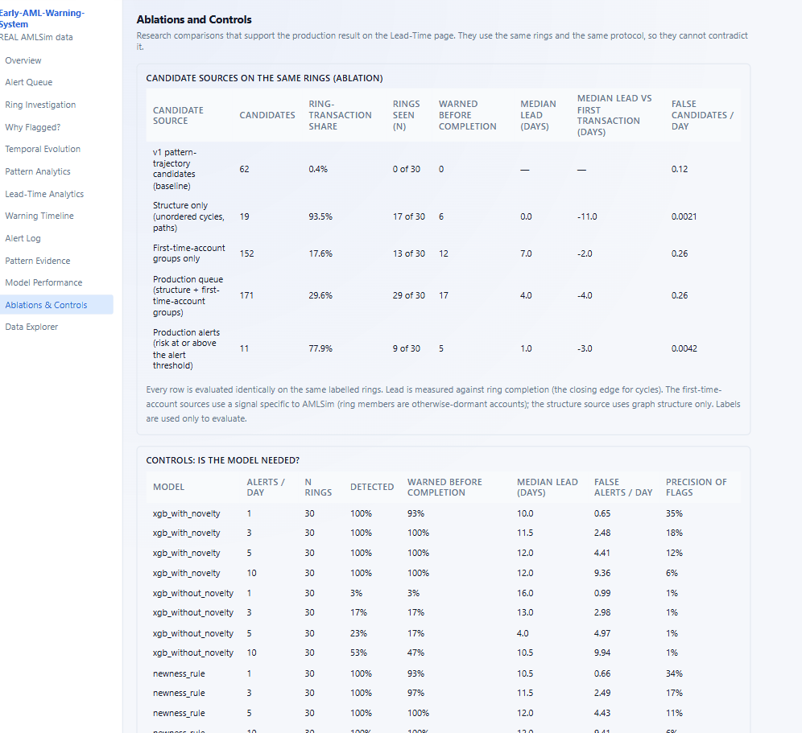

*Figure 13. Ablations and Controls. Candidate sources on the same 30 rings, controls (model with novelty, model without novelty, newness rule, random) and sensitivity to the forecast horizon.*

| Candidate source | Candidates | Ring-transaction share | Rings seen | Warned early | Median lead (days) | False candidates per day |
|---|---|---|---|---|---|---|
| Structure only (cycles, paths) | 19 | 93.5% | 17 of 30 | 6 | 0.0 | 0.0021 |
| First-time-account groups only | 152 | 17.6% | 13 of 30 | 12 | 7.0 | 0.26 |
| Production queue (both) | 171 | 29.6% | 29 of 30 | 17 | 4.0 | 0.26 |
| Production alerts (score 50 or more) | 11 | 77.9% | 9 of 30 | 5 | 1.0 | 0.0042 |

The two sources are complementary: structure is clean but late, first-time-account groups provide most early warnings. The controls are the most important result for interpretation. At 1 to 10 flagged transactions per day, the model with novelty features and the two-bit newness rule (flag a transaction if its sender or receiver is new) both detect 100% of rings and warn early for 93 to 100%. The same model without novelty features detects only 3% to 53% of rings, close to the random control (10% to 40%). **The early signal therefore comes from AMLSim's dormant-account construction, and the model adds nothing beyond a simple newness rule.** This is reported openly because real data may behave differently.

The horizon-sensitivity table shows the same caution: precision at a 2-day horizon is 0.32 without account history and 0.40 with it (Wilson 95% interval 0.17 to 0.61), and rows with different horizons are different tasks and are not comparable.

### 11.10 Comparison with the previous version of the project

| Measure | Previous version | Current version | Like for like? |
|---|---|---|---|
| Ring-transaction share of candidates | 0.3% (1.2 times background) | 29.6% for the queue (108.5 times) | Yes |
| Rings seen (of 30 evaluable) | 0 | 29 by the queue, 9 by alerts | Yes |
| Early detection | 0.0%, from one matched candidate | 17 of 30 (queue), 5 of 30 (alerts) | Yes |
| Lead time | -23 windows from one candidate (not meaningful) | Median 4.0 days (queue), 1.0 day (alerts, 95% interval 0 to 5) | Yes |
| False alarms | 98.9% of alerted candidates matched no ring | 2 of 11 alerts; 0.0042 per day | Partly (the earlier match rule was stricter) |
| Scoring | In-sample, including training windows | As of each day, out of sample | Method change |
| Candidates | 142 from 39,869 pattern events | 171 from structure and first-time-account groups; 179 pattern events | No |
| Class imbalance | 32 positives (0.0049%) at a 2-day horizon | 118 positives (0.0181%) at a 14-day horizon | No |
| Model precision on the same 2-day task | 0.294 | 0.32 to 0.40 (interval 0.17 to 0.61) | Yes |

The earlier problems were real: candidates rarely overlapped real rings, so false alarms were near 99% and no meaningful lead time could be computed. On the 2-day task, the model gain is small and uncertain; the jump from 0.294 to 0.750 precision in the headline table comes from changing to a 14-day task and must not be presented as a model improvement.

## 12. Discussion: Key Findings

The system confirms rings reliably and precisely but warns early mostly through a simulator shortcut. Nine findings explain why.

1. **Early alerts come from layering; closed cycles confirm only at completion.** All five early alerts involve layering (leads of 1, 2, 4, 5 and 10 days). The four true circular-flow alerts all arrived exactly at completion.
2. **The queue holds earlier signals than the alerts use.** The queue warns before completion for 17 of 30 rings against 5 for alerts, so the score, not candidate detection, is the bottleneck.
3. **The alert threshold is fragile.** Three candidates score 49.3 to 49.4 with no alert, and the documented run is the lowest of its five retrainings (11 alerts, range 11 to 16). At a threshold of 45 the same run gives 29 alerts, 86% precision, 24 of 30 rings seen and 10 early, but the threshold of 50 was fixed before the evaluation, so choosing 45 afterwards would be tuning on the results.
4. **Scores fade after a candidate's first day.** In a re-analysis of the stored score histories, 107 candidates have evidence on two or more days, and the behavioural component fell by more than 10 points in 82% of them (median 51 to 27). This explains the median of 0 days from creation to alert and the three alerts that later fell below 50. The likely cause, which has not been isolated, is that account newness fades quickly.
5. **One candidate type causes almost all the noise.** 123 of the 124 candidates that hold no ring transaction are fan-out groups, which are 75% of the queue.
6. **The early signal is the AMLSim dormant-account shortcut.** The two-bit newness rule matches the model, and without novelty features the model is close to random.
7. **The proposed model does not beat a baseline.** The temporal random forest has higher precision, recall and PR-AUC; the proposed model has the highest ROC-AUC. Class imbalance remains: 0.0181% of test rows are positive and recall is 12.7%.
8. **Alerts arrive after a ring starts.** Against a ring's first transaction the median lead is -3.0 days; the lead is measured against completion.
9. **Only 30 of 100 rings are evaluated**, all cycles, so conclusions about fan rings are not possible yet and the intervals are wide (Section 14).

## 13. Forensic Analytics Perspective

The course treats analytics as evidence-producing work: results must be traceable, reproducible, explainable and honestly bounded. The table shows how each principle is implemented.

| Forensic principle | How it is implemented here |
|---|---|
| Evidence traceability | Every candidate is linked to its accounts, roles and transaction identifiers; the Ring Investigation page lists each transaction (sender, receiver, amount, time) and its identifier. |
| Explainability and defensibility | The score calculation card reproduces every component from the code's own constants (weights, network rules, persistence formula) and the total ties to the stored score. Top contributing factors are written in words. |
| Separation of evidence from ground truth | Labels never build a candidate or a score. Every ground-truth statement on the dashboard is marked "AMLSim ground truth (used only to evaluate)". |
| Reproducibility | All results are produced from one configuration (`configs/config.yaml`) by `scripts/rebuild_v2.py`; queue-level results are deterministic; alert-level results are reported as ranges over five seeds. |
| Integrity of earlier results | Earlier results are archived in `results/v1_backup/` rather than deleted, and a test checks that no identifier from the old candidate set remains in the current results. |
| Change control | Dashboard updates were applied through a script that records file hashes, keeps backups and refuses to overwrite a file it does not recognise. |
| Honest reporting | Limits, intervals, controls and a negative result (the proposed model does not beat a baseline) are shown on the dashboard itself. |
| Chronological validity | Training, validation and test periods are disjoint and separated by a purge gap equal to the forecast horizon (Figure 0b). |
| Privacy | The data are synthetic; no real customer information is processed. |
| Investigative workflow | Triage (queue), investigate (evidence), explain (score card), decide (human). Guidance text states that a score is a priority signal and not a conclusion. |

## 14. Limitations and Threats to Validity

Thirty rings support the large claims but not the fine ones.

| Measure (30 evaluable rings) | Count | 95% Wilson interval |
|---|---|---|
| Queue sees the ring | 29 of 30 | 83% to 99% |
| Queue warns before completion | 17 of 30 | 39% to 73% |
| Alerts see the ring | 9 of 30 | 17% to 48% |
| Alerts warn before completion | 5 of 30 | 7% to 34% |
| Alerts that hold a ring transaction | 9 of 11 | 52% to 95% |
| Earlier candidates see the ring | 0 of 30 | 0% to 11% |

The improvement over the earlier candidates (0 of 30 against 29 of 30) is far beyond chance (Fisher exact p about 5e-16), but "17% early alerts" could truly lie anywhere between 7% and 34%.

**Internal validity**

- The behavioural model is retrained, so alert-level numbers move between runs (alerts 11 to 16, rings seen 9 to 13, early 5 to 6). Ranges are quoted.
- The threshold of 50 was fixed in advance. Results are sensitive to it (Section 11.6).
- Scores fade after a candidate's first day; the cause is not yet isolated.

**External validity**

- All results come from one simulated dataset. AMLSim draws ring members from otherwise-dormant accounts, so first-time accounts are unusually informative, and a two-bit newness rule matches the model.
- Only 30 of 100 rings are evaluable, all cycles. All 30 fan-in, all 30 fan-out and 10 cycle rings begin before the scored period, so early warning for fan rings is unmeasured.

**Construct validity**

- Lead is measured against ring completion (the closing edge of a cycle); against the ring's first transaction the median lead is -3.0 days.
- Patterns seen on candidate accounts by the original detectors do not separate rings from normal traffic (AUC 0.34) and are context only.
- Class imbalance is managed (PR-AUC, precision at K, Wilson intervals) but not solved; recall is 12.7%.
- The model comparison uses a shared compact feature set; the original multi-feature models have not been re-evaluated under the validated protocol.
- Ring reconstruction is partial: only transaction coverage (84% for the queue, 26% for alerts) is shown, not accounts recovered per ring.
- There is no real-data validation (for example Elliptic2 [4]) and no published temporal graph neural network baseline.

## 15. Testing and Quality Assurance

| Suite | Count and status | What it checks |
|---|---|---|
| Backend (`pytest tests`) | 253 tests in the reference run: 241 pass; 12 fail (a few tests skip if result files are absent) | Candidate construction, scoring arithmetic, evaluation definitions, warning log, API and database. The 12 failures are legacy tests of retired first-version modules (`test_trajectory.py`, `test_ring_candidates.py`); they test code the dashboard no longer uses. |
| Front end (`npx vitest run`) | 73 tests, all pass | Every page renders the numbers in the result files, tables tie to the underlying data, filters work, links open the chosen candidate, bars are proportional, and dates are correct. |

Quality measures that go beyond counting tests:

- **Cross-page consistency.** Pages read the same result files, and tests check that totals agree, so no page can contradict another.
- **Control tests.** The tests added for the review fixes were also run against the previous version of each page and had to fail there, to prove they detect the defect.
- **Time-zone test.** The page tests run in a UTC+5:30 time zone. This caught a real one-day date error (a window shown as 30 Jan instead of 31 Jan) that UTC-only tests could not see.
- **Leakage controls.** Chronological splits only; a purge gap at each boundary; labels excluded from candidate construction.
- **Reproducibility check.** After a rebuild the expected counts in Section 10.6 must match.

## 16. Future Work

1. Evaluate the 60 fan rings with a truncated-observable definition, which would raise the number of evaluated rings and add fan types.
2. Re-run the original multi-feature models under the validated protocol and compare them with the shared-feature models.
3. Generate more AMLSim rings with different seeds to narrow the intervals.
4. Validate on real data (Elliptic2 [4]) and add a published temporal graph neural network baseline.
5. Reconstruct each ring from the warning candidates and report accounts and transactions recovered, not only transaction coverage.
6. Investigate why scores fade after a candidate's first day, and whether a persistence-weighted score gives earlier and steadier alerts, declaring any change before testing it.

## 17. Responsible Use

A risk score indicates **investigative priority, not criminal guilt.** It is a computational hypothesis about a group of accounts and must be reviewed by a human investigator together with the underlying transactions before any decision. Results are experimental evaluation metrics for one simulated dataset and must not be read as evidence that the system is ready for production or as confirmation of suspicious activity. This statement appears on the relevant dashboard pages.

## 18. Conclusion

This project replaces candidates that rarely overlapped real rings (0 of 30 evaluable rings seen, about 99% false alarms, no usable lead time) with label-free candidates, an as-of-day explainable score and a ring-level early-warning evaluation. On 30 evaluable rings the whole queue sees 29 and warns before completion for 17 (median 4.0 days), while the 11 alerts are 82% precise and early for 5 (median 1.0 day). Controls show that much of the early signal comes from how AMLSim builds rings, and that the proposed classifier does not beat a random-forest baseline. The contribution is therefore a reproducible, evidence-linked and honestly evaluated pipeline, with its limits stated, which gives later work (fan rings, more rings, real data) a firm base to build on.

## 19. References

[1] M. Weber et al., "Scalable Graph Learning for Anti-Money Laundering: A First Look," NeurIPS 2018 Workshop on Challenges and Opportunities for AI in Financial Services, arXiv:1812.00076, 2018.

[2] M. Weber et al., "Anti-Money Laundering in Bitcoin: Experimenting with Graph Convolutional Networks for Financial Forensics," KDD 2019 Workshop on Anomaly Detection in Finance, arXiv:1908.02591, 2019.

[3] E. Altman et al., "Realistic Synthetic Financial Transactions for Anti-Money Laundering Models," Advances in Neural Information Processing Systems (NeurIPS), Datasets and Benchmarks Track, arXiv:2306.16424, 2023.

[4] C. Bellei et al., "The Shape of Money Laundering: Subgraph Representation Learning on the Blockchain with the Elliptic2 Dataset," arXiv:2404.19109, 2024.

[5] F. T. Liu, K. M. Ting and Z.-H. Zhou, "Isolation Forest," in Proc. IEEE International Conference on Data Mining (ICDM), 2008, pp. 413-422.

[6] L. Breiman, "Random Forests," Machine Learning, vol. 45, no. 1, pp. 5-32, 2001.

[7] T. Chen and C. Guestrin, "XGBoost: A Scalable Tree Boosting System," in Proc. ACM SIGKDD International Conference on Knowledge Discovery and Data Mining, 2016, pp. 785-794.

[8] E. B. Wilson, "Probable Inference, the Law of Succession, and Statistical Inference," Journal of the American Statistical Association, vol. 22, no. 158, pp. 209-212, 1927.

[9] T. Saito and M. Rehmsmeier, "The Precision-Recall Plot Is More Informative than the ROC Plot When Evaluating Binary Classifiers on Imbalanced Datasets," PLOS ONE, vol. 10, no. 3, e0118432, 2015.

[10] Financial Action Task Force, "International Standards on Combating Money Laundering and the Financing of Terrorism and Proliferation: The FATF Recommendations," FATF, Paris (updated periodically).

[11] IBM, "AMLSim: a multi-agent financial transaction simulator for anti-money-laundering research," GitHub repository, github.com/IBM/AMLSim.

## 20. Team and Contributions

| Team member | Registration number | Contribution |
|---|---|---|
| [Name 1] | [Reg. No.] | [for example: candidate construction, risk scoring, evaluation protocol] |
| [Name 2] | [Reg. No.] | [for example: backend API, database, testing] |
| [Name n] | [Reg. No.] | [for example: dashboard, documentation, analysis] |

Course: CSE4074 Forensic Analytics, Vellore Institute of Technology, Chennai. Semester: Fall 2026-27. Professor: Dr. S. Johanan Joysingh.

## 21. Appendix: Glossary

| Term | Meaning |
|---|---|
| Candidate | A group of accounts and transactions hypothesised as a ring, built without labels |
| Queue | All candidates ranked by risk score |
| Alert | A candidate whose score reached the threshold (50) on some day |
| Evaluable ring | An AMLSim ring whose transactions all fall in the scored period and that completes inside the data |
| Completion day | For a cycle, the day of its closing (last) transaction |
| Lead time | Completion day minus warning day; positive means warned before the ring completed |
| Coverage | Share of a ring's transactions that sit inside warning candidates |
| Ring-transaction share | Share of candidate transactions that belong to a ring; compared with the background rate to give an enrichment |
| Warm-up (burn-in) | The first simulator days, excluded because accounts have no history yet |
| Newness rule | Flag a transaction if its sender or receiver has never transacted before |
| Purge gap | Days left empty between training and testing so that no label looks into the future |
| PR-AUC | Area under the precision-recall curve; the informative metric when positives are rare |
| Precision at K | Share of the K highest-ranked items that are positive |
| Wilson interval | A confidence interval for a proportion that stays sensible for small counts |
| Retraining stability | Re-scoring the same candidates after retraining the behavioural model with different random seeds |
| Fan-in, fan-out | One account receiving from, or paying, several counterparties |
| Layering | A path or chain of transfers that obscures the origin of funds |
| Circular flow | A closed cycle of money |

